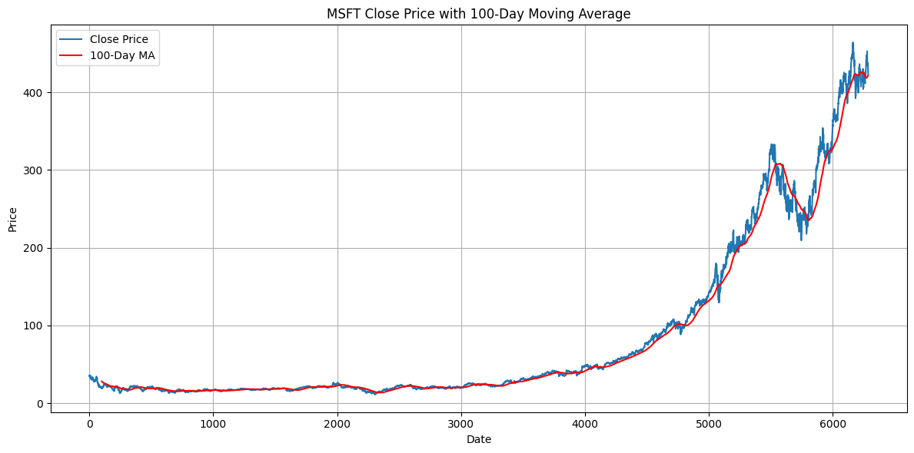
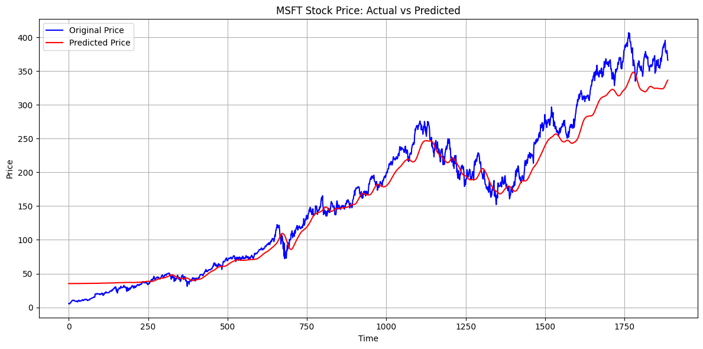

# 📈 Stock Trend Prediction App

[](https://www.python.org/)
[](https://streamlit.io/)
[](https://www.tensorflow.org/)
[](https://pypi.org/project/yfinance/)
[](https://avnish-stock-trend-prediction.streamlit.app/)

---

## 📌 Overview

🔮 **Stock Trend Prediction App** is a Streamlit-powered web interface that utilizes a pre-trained LSTM model to forecast stock closing prices. It provides interactive data visualizations, moving average analysis, and future trend predictions based on historical time-series data fetched seamlessly from Yahoo Finance (`yfinance`).

> 🧠 The model (`keras_model.h5`) was trained using a Long Short-Term Memory (LSTM) architecture on historical stock data.

🎯 Built for ML learners, finance enthusiasts, and academic or personal portfolio projects.

---

## ⚙️ Features

- 📊 **Interactive Visualizations**: Interactive Plotly and Matplotlib charts for closing prices, 100-day and 200-day moving averages  
- 🧠 **LSTM Predictions**: Forecast trends and next-day price projections using a trained Long Short-Term Memory model  
- 📈 **Evaluation Metrics**: Real-time RMSE, MAE, and MAPE calculations on out-of-sample test data  
- 🔄 **Zero-Config Data Pipeline**: Instant, free historical data via Yahoo Finance (`yfinance`) with no API keys or rate limit barriers  
- 💡 **Educational Focus**: Designed for understanding deep learning in financial applications  

---

## 🛠️ Tech Stack

| Component            | Library / Tool      | |
|---------------------|---------------------|------|
| Web Interface        | Streamlit           |  |
| Deep Learning Model  | TensorFlow / Keras  |  |
| Financial Data       | Yahoo Finance (`yfinance`) |  |
| Visualization        | Plotly & Matplotlib |   |
| Data Processing      | pandas, NumPy       |   |
| Scaling & Metrics    | scikit-learn        |  |

---

## 🗂️ Project Structure

```

stock-trend-prediction/
├── keras_model.h5          # Trained LSTM model
├── app.py                  # Streamlit application
├── README.md               # Project overview
├── requirements.txt        # Python dependencies
├── output_graphs/          # Prediction and training result visualizations
│   ├── 100 and 200.png
│   ├── 100.png
│   └── Predicted.png

````

---

## 🧭 Getting Started

To explore and experiment with stock trend forecasting using deep learning, clone this repo and follow the steps below.  
Make sure you have **Python 3.10+** installed.

---

## 🚀 How to Run

1. **Install the required packages**

   ```bash
   pip install -r requirements.txt


2. **Place the trained model**

   Ensure `keras_model.h5` (trained LSTM model) is present in the root directory.

3. **Run the application**

   ```bash
   streamlit run app.py
   ```

4. **Interact**

   Open your browser and go to `http://localhost:8501` to interact with the app.

---

## 📷 Output Visualizations

<div align="left">
   
   
   
</div>

---

## 🔒 Disclaimer & Limitations

### **⚠️ This application is intended strictly for educational and demonstrative purposes.**

The predictions made by this application are the result of a deep learning model trained on historical data and **should not be used to make actual investment or trading decisions**.

### ❗ Important Notes:

* This project **does not provide financial advice**.
* The developer and contributors **are not licensed financial advisors**.
* **No liability or responsibility** will be accepted for any financial loss or damage incurred due to reliance on the outputs of this app.

### ⚠️ Limitations:

* Model performance is limited by:

  * Quantity and quality of historical market data
  * Lack of awareness of company fundamentals, breaking news, or macroeconomic indicators
  * Overfitting or underfitting inherent to time-series forecasting models

* It **does not account for**:

  * Intraday volatility
  * Real-time streaming order book data
  * Sudden market shifts, earnings surprises, or geopolitical events

### 📘 Use Responsibly:

This project is intended to showcase:

* Time series forecasting using LSTMs
* Interactive dashboard deployment using Streamlit and Plotly
* End-to-end data processing, feature scaling, and inverse transformation pipelines

**It is NOT designed for live trading, algorithmic execution, or portfolio management. Any usage beyond educational or research purposes is strongly discouraged.**

---

## 🔐 Privacy & Security

If deployed publicly, this app:

* **Does not collect or store personal user data**
* **Processes ticker inputs locally in-session**
* Relies on publicly accessible data via Yahoo Finance (`yfinance`)

> Always validate external data input sources and sanitize ticker symbols in production.

---

## 🤝 Contributing

Contributions are welcome!
Please open an issue to discuss changes or improvements before submitting a pull request.

If you'd like to add features, improve model performance, or extend visualizations — feel free to fork and build upon it.

---

## 🙋 Author

Developed by **@Avnish1447**


[](https://github.com/Avnish1447)&nbsp;&nbsp;[](mailto:avnishagrawal1447@gmail.com)&nbsp;&nbsp;[](https://www.linkedin.com/in/avnish-agrawal-84b39728a/)


---

✨ Happy Learning & Responsible Forecasting 📉📈
